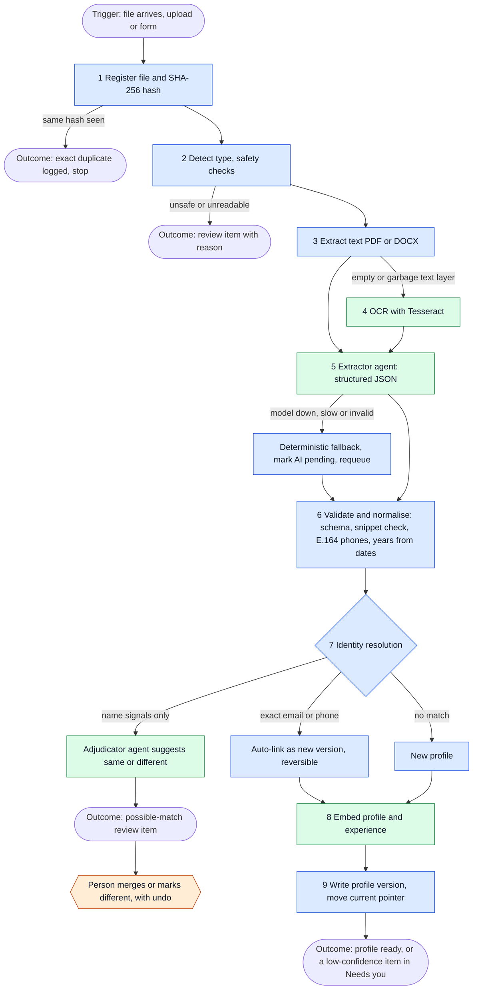
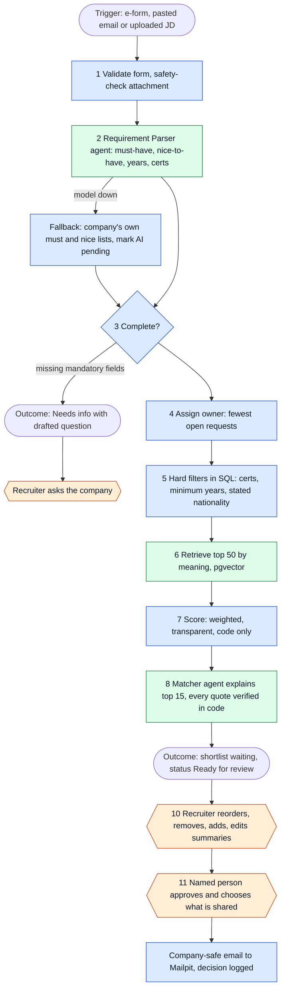

# Defence pack

Diagrams render on GitHub, in VS Code (Markdown preview) and at mermaid.live. Step tables with notes are in ARCHITECTURE.md sections 2 and 3.

Legend for both workflow diagrams: **blue = code**, **green = AI agent or model**, **orange = a named person decides**.

## 1. Workflow A: a CV arrives

Trigger: a new or changed file in the CV folder or inbox, a UI upload, or the add-candidate form. Outcome: one profile per person with the latest CV current, or a review item waiting in "Needs you".

| Step | Actor | Why this actor | If it fails |
|------|-------|----------------|-------------|
| 1 Hash | Code | One right answer | Job retried |
| 2 Safety | Code | Security rules must be deterministic | Review item with the reason |
| 3 Extract text | Code | Libraries do this exactly | Review item (legacy .doc, corrupt file) |
| 4 OCR | Tesseract | Only for scans; a vision LLM is slower and heavier | Review item "unreadable scan" |
| 5 Extract fields | Agent (qwen2.5:7b, local) | Messy layouts need language judgment | Regex and lookup fallback, "AI pending", requeued |
| 6 Validate | Code | Every AI output is checked against schema and the CV text | Dropped fields flagged for review |
| 7 Identity | Code, then agent | Exact keys are code. Agent only suggests on name-only pairs | Never auto-merged |
| 8 Embed | nomic-embed-text, local | Needed for search by meaning | Keyword search still works |
| Merge | Person | A merge changes a record others rely on | Undo from Activity |

## 2. Workflow B: a hiring request arrives

Trigger: company e-form through its signed link, or a recruiter pastes an email or uploads a job description. Outcome: a shortlist waiting for a recruiter. Nothing leaves Agentic HR until a named person approves.

| Step | Actor | Why this actor | If it fails |
|------|-------|----------------|-------------|
| 1 Validate | Code | Untrusted input, fixed rules | 400 with a plain message |
| 2 Parse | Agent (qwen2.5:7b) | Companies write free text | Fallback to the company's own lists, requeued |
| 3 Completeness | Code | A checklist | Needs info |
| 4 Owner | Code | A rule | The request continues and any recruiter can assign an owner |
| 5 Filters | Code (SQL) | Exact requirements | Never silently dropped: unknown years are kept and shown as unknown |
| 6 Retrieve | Embeddings | Matches meaning, not keywords | Falls back to keyword rank |
| 7 Score | Code | Must be explainable and reproducible | n/a |
| 8 Explain | Agent (qwen2.5:14b) | Plain-words reasons | Unverified quotes are dropped; list still shows scores |
| 10-11 Decide | Person | Anything leaving Agentic HR | Cannot be skipped |

## 3. Copilot Studio: for and against

**What Copilot Studio does well (be fair about this)**
- It already lives inside Microsoft 365: identity, SharePoint, OneDrive and Outlook connectors work out of the box, and IT already knows how to govern it.
- Fast to stand up simple flows such as "new email, then create a row, then notify someone". Non-developers can edit them.
- Data stays in the Microsoft compliance boundary, which answers the executives' first question quickly.
- Familiar admin controls, DLP policies and tenant-level audit.

**Why it is the wrong tool for this problem (tied to the requirements)**
| Need | Copilot Studio | This hub |
|------|----------------|----------|
| 4.x identity resolution: never merge two different people, always undo | Merge rules and undo snapshots are hard to express in a visual flow, and harder to test | Rules are code with tests. Merges are human-only with a stored snapshot |
| 3.x shortlist where every claim quotes the CV | No built-in step to verify a quote against source text | Code verifies each quote and drops unverified claims |
| Measured accuracy (README section 6) | Limited evaluation tooling and versioning of agents | Versioned prompts, eval scripts, 276 automated tests |
| 7.5 audit: who, what, model, prompt version, when | Conversation-level analytics, coarser than per-step records | One audit row per agent step and human action |
| Choice and control of the model that sees CV text | Models are chosen by the platform | Model names are config. Any local model, swappable |
| Volume: 11,000 CVs and growing | Message and capacity based licensing grows with every CV and every explanation | Runs on your own hardware, no per-CV fees |
| Safe handling of hostile files and text | Limited control over parsing, file safety and prompt-injection defence | Magic-byte checks, macro rejection, text treated as data, schema-checked output |
| Change and testing | Visual flows are difficult to diff, review and roll back | Git, CI, migrations, rollback |
| Phone and Outlook-style UI built for this team | Chat-style surface | 3-pane inbox with "Needs you" |

**On the data security worry that started the discussion**
- Copilot Studio keeps data in Microsoft, but candidate data would still pass through connectors, a shared model service and flow run history that Agentic HR does not control in detail.
- This hub runs on Agentic HR's own machine. CVs stay on its disk, the models run locally, nothing is used for training, and every access is in an audit log that an administrator owns.
- If the company later wants a Copilot front end or Microsoft 365 connections, they can be added around the hub. The logic stays testable.

**Honest limits of our approach:** we own the code, so we own the maintenance. That needs a named engineer owner, which is why the pack includes tests, a status page and a ticket flow.
